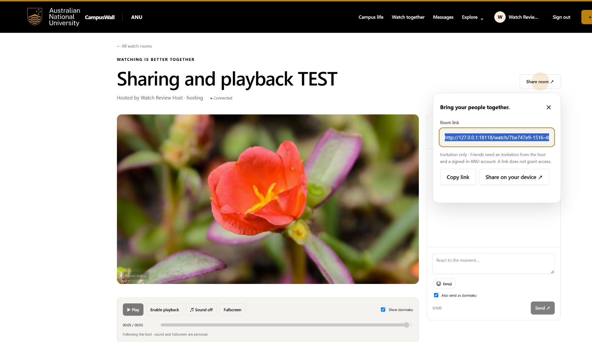
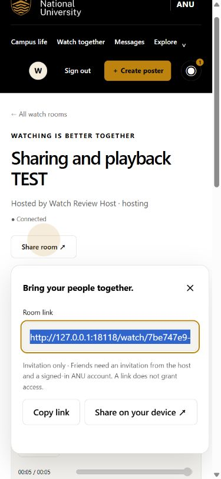
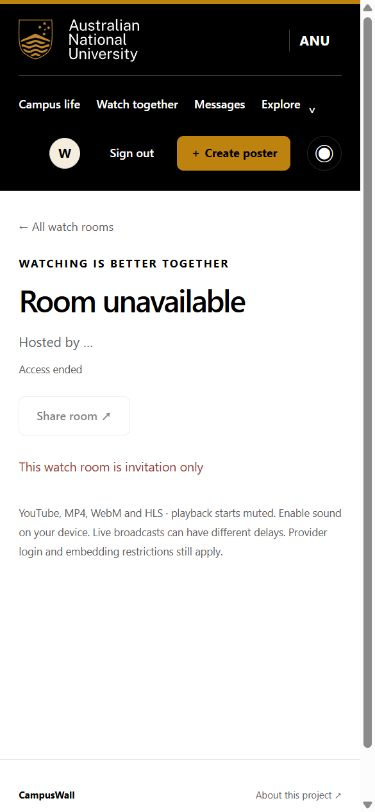

# Watch-room feedback and verification, 3 October 2026

## Report and scope

The student relayed a friend's feedback in the working conversation: room sharing and video playback stutter need attention. This is an English summary of the student's message, not a verbatim English quotation or an observed classroom demonstration. The original browser, provider, network and exact failure steps were not supplied. The student explicitly clarified that the separate term “volting” did not mean voting; its meaning remains unresolved. No voting rule was redesigned on that assumption.

## Problems established by inspection and regression fixtures

Sharing offered clipboard copying with no selectable link when the clipboard was unavailable. Permission failures left the page looking like a room still loading. Playback corrections could seek on non-playback revisions, retry ordinary corrections every timer tick and keep advancing the saved clock while the host buffered. Autoplay denial also allowed repeated automatic attempts. These are independently established implementation defects or failure cases, not a claim to have reproduced the friend's unidentified setup.

The repair in [f8c3ead](https://github.com/comp4020-agentic-coding-studio/comp4020-final-lzm-1024/commit/f8c3eadf4054462b060177ffb98b5223f177d420) adds a share panel with a canonical room URL, manual-copy fallback, optional device sharing and campus/invitation instructions. Access errors appear above a hidden player layout. Host buffering now freezes the durable clock while preserving play intent. Normal viewer corrections need more than four seconds of drift and a five-second cooldown; explicit playback changes can synchronise sooner. Presence/privacy revisions do not force seeks. Browser-denied autoplay waits for a user gesture. HLS enables its worker and bounded buffers; known live playlists avoid VOD-clock seeks.

## Verification

- TypeScript and all **21 top-level checks passed**, in 42.32 seconds against an isolated preview on port 18118. The first full attempt exposed three expected-schema assertions still requiring version 13; they now require version 14. Permission and data-preservation assertions remain in place.
- The final targeted run passed **24 nested Node checks** across [player](../scripts/watch-player.test.mjs), [sharing](../scripts/watch-share.test.mjs) and [server](../scripts/watch.integration.mjs). These counts overlap the full-run wrappers and must not be added to 21. Coverage includes stale revisions, duplicate requests, viewer rejection, buffered restart/resume, manual pause while buffering and autoplay denial.
- Actual browser checks used separate localhost and 127.0.0.1 sessions with disposable ANU accounts. The shared URL redirected an unsigned guest to sign-in and returned to the room afterwards. Clipboard copying reported acceptance. An invitation-only room refused an uninvited guest; after the host invited that account, the same link opened the room and showed two online members. Escape restored focus to Share room.
- A public [MDN CC0 flower clip](https://interactive-examples.mdn.mozilla.net/media/cc0-videos/flower.mp4) played through the room in both sessions. Its duration was 5.055 seconds. At the end, the host was at 5.055 and the guest at approximately 5.047, both paused. This brief transport check does not establish frame-exact synchronisation or long-film stability.
- Layout checks used **1920×1080** and **390×844**. The phone document's client and scroll widths were both 375 pixels; the desktop's were both 1905 pixels. Screenshots document actual local test UI, not production user activity.

## Limits and follow-up

HLS configuration and YouTube state handling have regression coverage, but this run did not benchmark streaming throughput or replay the friend's actual source. The video provider still controls availability, embedding, formats and CORS; user networks and live broadcast delay remain outside the shared clock's guarantees. Device sharing was offered, not sent to an external recipient. No production test accounts, messages or rooms were created. At the time of this 3 October entry, no completed instruments-only classmate demonstration had been reported.

## Classmate feedback reported on 19 October 2026

The student identified the two participants as friends Tony and Kevin and clarified that they had actually tried the website. They reported YouTube playback stutter. The student clarified that some features became known to the visitors only after the student introduced them. The first-use difficulty was discovering what the website offered, not merely learning controls after finding a feature. This is an English summary of the student's report, not a verbatim quotation or direct observation by the agent. The student confirmed that the session took place on 14 October 2026 with two participants, Tony and Kevin. The site offers many functions, so the visitors did not already know everything they could look for.

This report adds real first-use feedback to the technical record. It does not establish that every feature was confusing, that the tasks failed, or that exploration itself was a problem. The useful question is whether clearer labels, visible feature summaries or a starting point could reduce the need for the developer to explain what is available.

The student separately clarified that the original YouTube site was smooth while CampusWall paused or jumped. Later regressions reproduced two possible contributors: immediate drift correction after buffering and a lost playback action while awaiting a server response. Commits a404d35 and 4d3396c repair those cases. Automated checks and deployment passed, but no classmate retest after those fixes has been reported. Do not describe the user-reported problem as confirmed solved by participants.

At the time of the October report, possible follow-up work included a short optional introduction, clearer entry labels and starting tasks. The November implementation update below records which responses were later built. A later participant session should record the exact feature a person tried to find, the route they took, any help needed and whether the task was completed.

The student confirmed that this was normal website use followed by feedback, not the Crit 10 instruments-only procedure. Real website use and a narrator explaining actions from logs alone are separate claims. The required instruments-only session still needs its own record; no log-only narration results are invented here.

## Implemented first-use responses, 8 November 2026

The wall now offers a New here? banner, a public Getting started guide and a persistent guide entry after the banner is dismissed. The guide groups features by the visitor's goal and explains where to find their controls. [7e4769e](https://github.com/comp4020-agentic-coding-studio/comp4020-final-lzm-1024/commit/7e4769e) makes the returning-visitor guide entry a button and adds connection-loss guidance. [ef546c6](https://github.com/comp4020-agentic-coding-studio/comp4020-final-lzm-1024/commit/ef546c6) corrects its first step to name ANU, the one currently open campus. Missing publication fields also receive numbered recovery instructions, recorded in [verification](VERIFICATION.md).

These changes address the reported discovery problem in the interface. They do not establish that students now discover features without help: no follow-up observation from Tony or Kevin has been supplied. The next check should ask a visitor to find an event, contact its organiser and locate shared editing without spoken instructions, recording any help needed rather than assuming success.

## Week 11 tutorial account, reported on 8 November 2026

The student now confirms a separate, completed instruments-only demonstration during the Week 11 tutorial with Group 3. Four people took part. Activities included sharing the website link, posters and video rooms, and testing games. Language and video problems appeared. The exact date, individual log events, narration comparisons and a participant retest result have not been supplied. This updates the earlier statement that no instruments-only session had been reported; it does not convert the 14 October normal-use feedback or local rehearsals into that demonstration. See [the tutorial record](CRIT10-DEMO.md).
