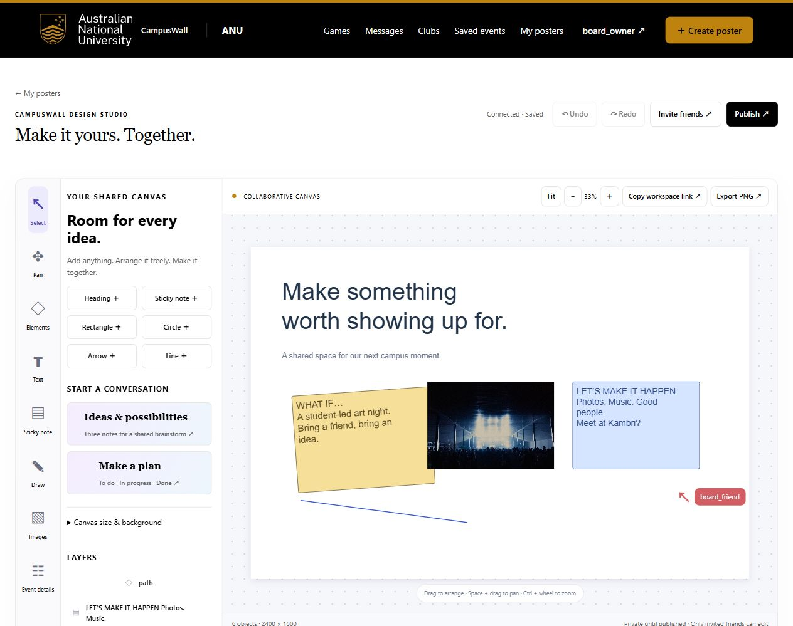
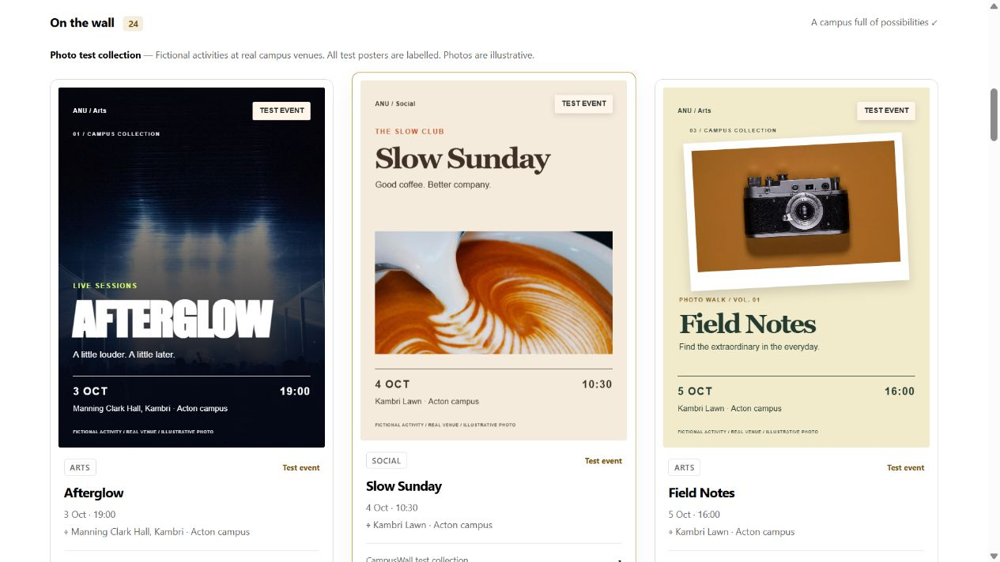
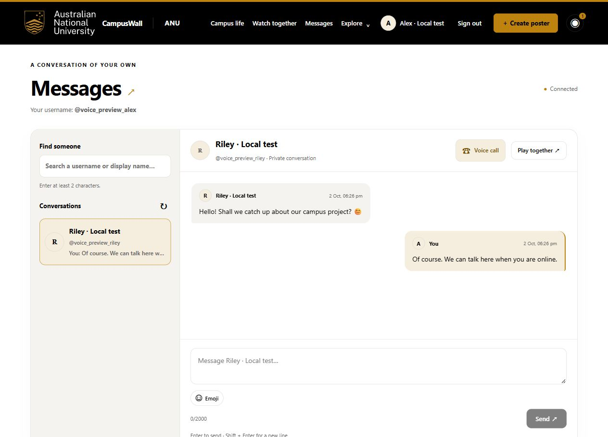
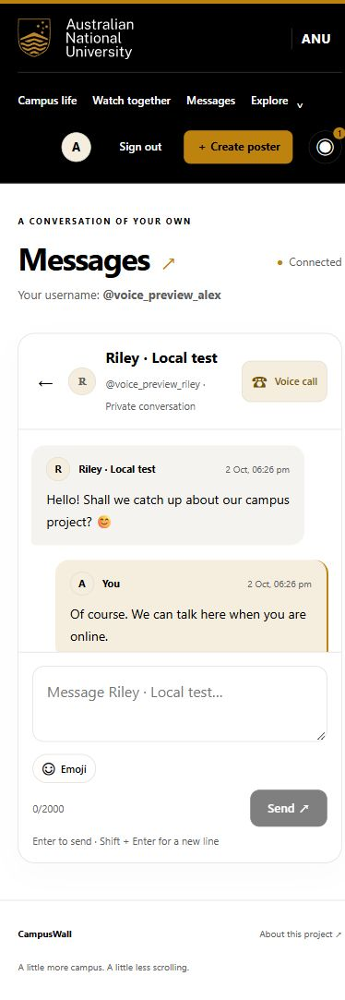
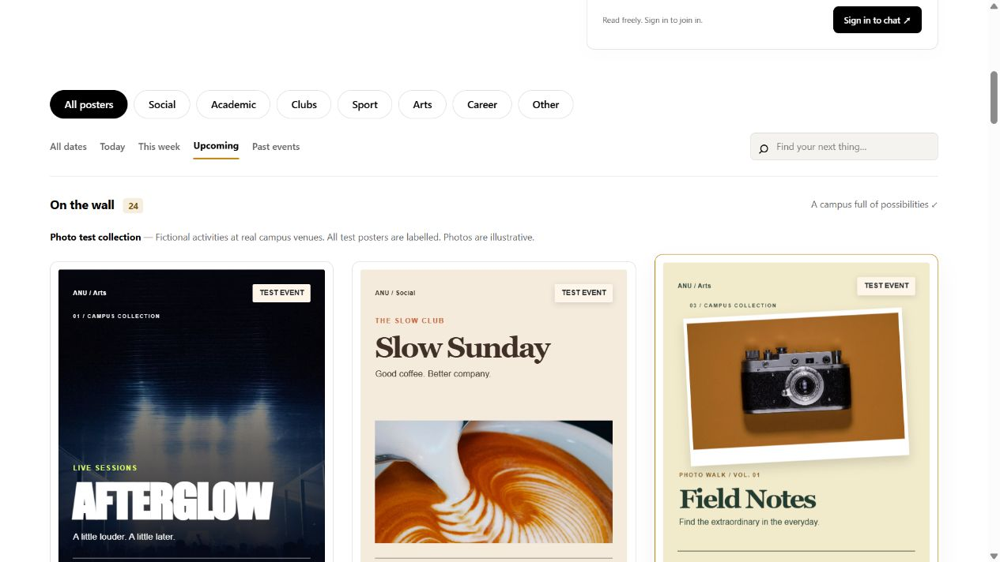
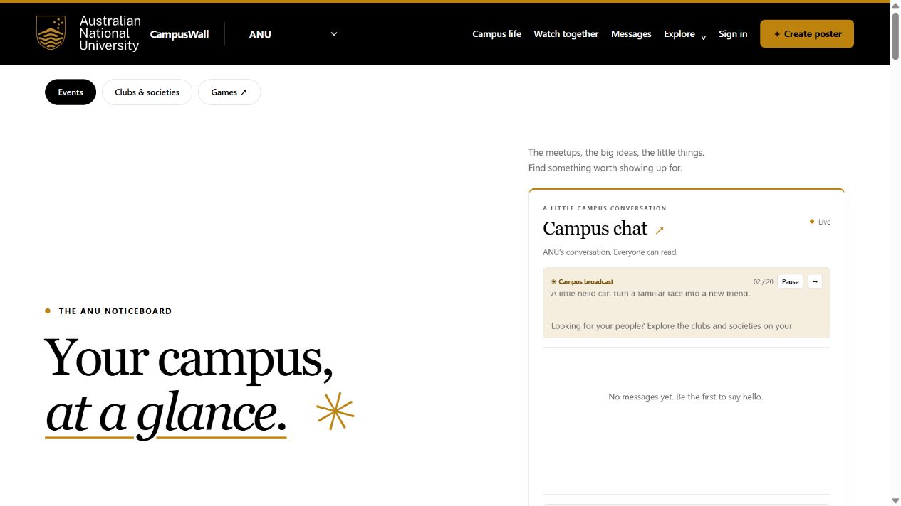
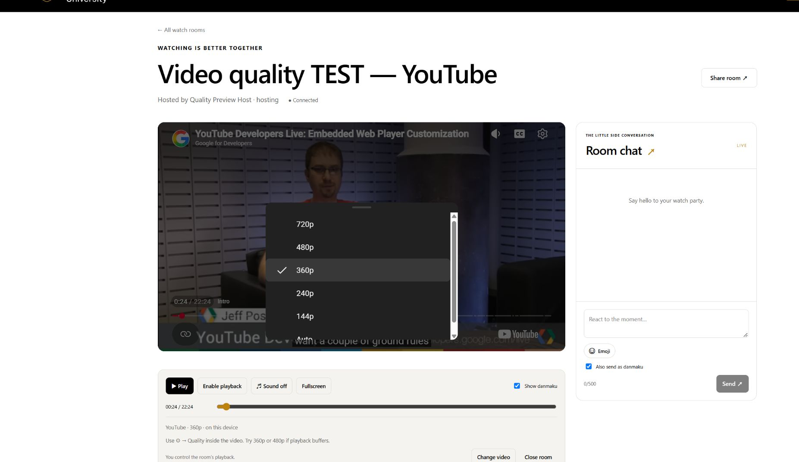
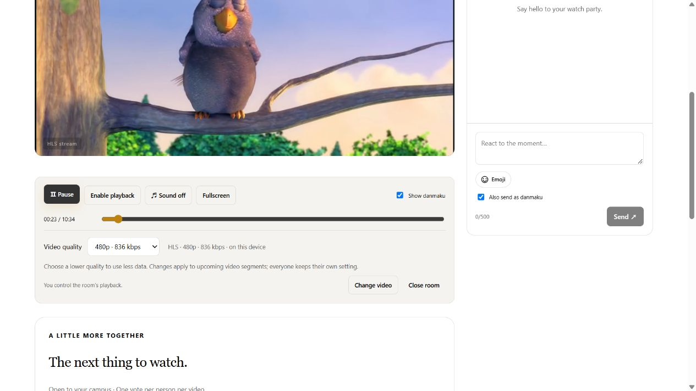
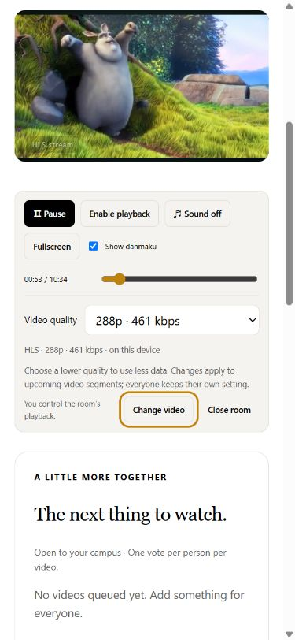

# Verification record and reproduction

## What has actually been checked

On 2 October 2026, the last pre-documentation full run passed TypeScript and **19 top-level Vitest checks**: the two supplied HTTP invariants plus seventeen product wrappers. The wrappers run nested Node test scenarios; counts from earlier development logs use that different level and must not be added to nineteen. The voice wrapper additionally runs real native WebRTC peers with synthetic audio. Final documentation verification results are recorded below after rerunning.

The production smoke from the voice deployment verified eight campus walls/logos/chat channels, 24 photographic TEST notices per campus, 24 local photo files, 1,905 directory entries, ten games and protected APIs. Six deployed frontend files matched tested source hashes. These checks neither create real student activity nor exercise production microphone calls.

| Evidence | What it supports | What it does not establish |
| --- | --- | --- |
| Two authenticated WebSocket clients | Specified live collaboration, access revocation and retry behaviour | Latency on every network or simultaneous campus-wide load |
| Restart fixtures | Saved accepted records survive a process restart | Backup recovery after storage loss |
| Actual native WebRTC with generated sound | Both peers receive decoded non-silent audio through authenticated signalling | Browser microphone permissions or restrictive campus NAT traversal |
| Mocked media-player tests | Host event handling, buffering guards and delayed acknowledgement behaviour | Every provider's playback availability |
| Browser preview and screenshots | Visible controls and observed layout, including a 390 px phone | Unassisted task success, complete accessibility or real adoption |
| Local benchmark | Measured loopback fixture before/after change | Production response-time guarantee or agent productivity |

## Run the application and checks

Use Node.js 24 and pnpm 11. Install with `pnpm install --frozen-lockfile`. In a PowerShell terminal:

```powershell
$env:DATA_DIR = Join-Path (Get-Location) '.local-data'
$env:PORT = '8080'
pnpm start
```

Then, in another terminal:

```powershell
$env:APP_URL = 'http://localhost:8080'
pnpm check
pnpm check:evidence
pnpm docs:check
```

`pnpm check` needs the running app for supplied HTTP invariants. Product scripts create isolated databases and use their own fixed local ports; do not run competing copies of the integration suite concurrently. Some native development dependencies need network access during installation. The native WebRTC fixture has a documented compatibility adapter/exit for its test binding; this binding is not shipped in production. No microphone is accessed by that test.

The original evidence validator checks reflection filenames, harness presence, template removal and resolution of cited hashes. It **does not judge** whether writing is the student's, whether a cited commit supports a claim, or whether future crit work actually occurred. `pnpm docs:check` adds mechanical word-range and local-link checks. Review remains necessary.

For read-only production verification:

```powershell
$env:APP_URL = 'https://comp4020-final-lzm-1024.fly.dev'
pnpm smoke:deploy
```

Do not test real bookings, invitations, room closures or calls by modifying existing production records. Use local fixtures for actions with persistent effects.

## Screenshots and provenance

These are retained screenshots of prior checks, copied into this repository on 2 October 2026. They show local disposable users or published TEST material, not a participant study or additional verification conducted during documentation writing.



The whiteboard image illustrates collaborative controls; the operation/permission assertions are in [whiteboard integration](../scripts/whiteboard.integration.mjs).



The photo wall illustrates demonstration content; venue existence and image attribution are documented in [sources](../data/PHOTO-POSTER-SOURCES.md).





## Human checks still needed

Evaluate 1920×1080 and 390×844 exactly, not merely a similar desktop width. Test keyboard-only navigation, modal focus, reduced motion, real microphone calls and restricted networks with a configured TURN relay. Run uncoached discovery/collaboration tasks with actual students and record failures. The existing browser records do not establish all of these outcomes.

Crit 10 now has redacted per-action logging, an instruments viewer and hostile-input/restart tests. See [demo preparation](CRIT10-DEMO.md). The actual classmate demonstration remains outstanding. [Readiness acceptance](ACCEPTANCE.md) records the two-session rehearsal at the exact viewports; it does not claim exhaustive accessibility or a student study.

Documentation deployed: deployment-01M3Y4HB9FA3QB8YWSZREYFRVX, image sha256:9444e0ca86765506ccf28f23c5c3753af58955f535f0468c4397b81dcbb72b8d. Full live README text matches the local document after normal HTML newline normalisation; the production smoke passed. Browser observation confirmed all four section headings and the complete argument at /readme/. Only README is published by the current image; research/process/reflections and the supporting guide remain repository files for student review. No production fixture data was created. The owned local preview and disposable helper/database files were removed.

## Second performance pass, 2 October 2026

TypeScript and all 20 top-level checks passed in 43.85 seconds. The performance wrapper now covers bounded community queries, omission of private draft columns, lazy-service login/logout races, formatter compatibility, published canvas CSS and cancelled wall requests. Existing animation, game, collaborative editor, private chat, watch-player and real synthetic WebRTC checks also passed. See [performance evidence](../data/PERFORMANCE.md) for precise fixture measurements, unchanged-response assertions and the absence of a claimed HTTP latency improvement. Browser checks used one disposable local account and private board; production records were not used for write tests.

Deployed as `deployment-01M3Y8XT8BCM7ERXGZAC0MNHQG`, image `sha256:c61242e8b8e1cebd5b370c83c28767e32f2335d9db4c4cf797bf8dfc5788b957`. The read-only production smoke passed, and six changed public modules/stylesheets matched their local SHA-256 hashes. Live browser observation confirmed 24 ANU photo cards, an active read-only guest chat and deferred editor CSS. The temporary local preview and fixture database were removed. This screenshot records production appearance after deployment; it is not evidence of a whole-page loading-time gain.



## Readiness implementation, 3 October 2026

TypeScript and all 21 top-level checks passed in 43.36 seconds against the local preview (`APP_URL=http://localhost:18116`). The first attempted run lacked the correct preview URL and could not start its global setup; the corrected run passed. New coverage includes strict log redaction, bounded collector backpressure, real HTTP/socket outcomes, stable pseudonyms after restart and SVG keyboard selection/focus. Documentation checks passed with all English text and valid local links; PROCESS is 996 words and the research argument remains 768 words. The evidence checker resolves all three real cited commits.

Implementation commit: [7b89037](https://github.com/comp4020-agentic-coding-studio/comp4020-final-lzm-1024/commit/7b89037d6519a36aed08ef1fb37f9a83639233dd). Deployed as `deployment-01M3YFEKP9V07RN4RJJRKA282Q`, image `sha256:fb3b65ed1849c0f9db5cdb4762f763fa2f828313f59c041db573ac4e5fc83cb3`. Fly health checks and the read-only production smoke passed: eight campuses, 192 photographic TEST notices, 1,905 clubs, ten games and protected APIs. The live instruments viewer displayed opaque actors, accepted connections and rejected operations without private content. Browser observation confirmed the updated public wall and guest read-only chat.

The exact viewport and two-session local rehearsal is documented in [ACCEPTANCE](ACCEPTANCE.md), including the keyboard failure found and repaired. This technical evidence does not claim a completed classroom demonstration. The real participants and observations must be recorded after [the instruments-only demo](CRIT10-DEMO.md).



## Watch-room feedback repair, 3 October 2026

Implementation: [f8c3ead](https://github.com/comp4020-agentic-coding-studio/comp4020-final-lzm-1024/commit/f8c3eadf4054462b060177ffb98b5223f177d420). TypeScript and all **21 top-level checks passed** in 42.32 seconds against the isolated preview on port 18118. Three old schema assertions initially required version 13; the additive buffering migration advances the database to 14, and the assertions now require that exact version. Existing preservation and permission checks remain. After the final cleanup, the targeted player/share/server run passed **24 nested checks**, which overlap the full-run wrappers.

[Feedback evidence](FEEDBACK.md) records the student's report, the defects established independently, two-session login/invitation sharing, a real 5.055-second MP4 clip, keyboard sharing and exact desktop/phone layout checks. HLS settings are regression-tested configuration; no streaming throughput gain or universal provider availability is claimed. These local disposable accounts do not represent a completed Crit 10 classmate demonstration. Publishing follows the existing main-branch check/deploy workflow; production validation remains read-only.

## Video quality controls, 3 October 2026

TypeScript and all **21 top-level checks passed** in 54.80 seconds against the isolated preview on port 18120. The player wrapper includes **11 quality regressions**, overlapping the top-level total. They verify source-level indices, audio-only exclusion, duplicate resolutions, non-flushing HLS selection and Auto, malformed/stale choices, source replacement, native mute state, independent viewers without room control writes, native/file limitations and YouTube speed restoration without callback loops. No provider quality setter is used for YouTube.

Actual browser checks used one disposable local account and two explicitly named TEST rooms. The official Google for Developers [embedded-player demonstration](https://www.youtube.com/watch?v=M7lc1UVf-VE) exposed 720p, 480p, 360p, 240p, 144p and Auto through the English native settings. Selecting 360p changed both the provider settings and the application's reported resolution. The public [HLS demonstration source](https://test-streams.mux.dev/x36xhzz/x36xhzz.m3u8) supplied five video variants. Selecting 480p at 1920×1080 produced actual 480p playback; the video advanced to approximately 23.88 seconds with `paused=false` and ready state 4. At 390×844, selecting 288p produced actual 288p playback at approximately 54.08 seconds. Keyboard Home then Tab restored Auto while playback continued at approximately 79.67 seconds. Neither viewport had horizontal document overflow.

These observations establish available controls and actual variant switching for these sources, not a measured bandwidth gain, universal availability or reproduction of the friend's original stutter. Test users and rooms existed only in the disposable local fixture. No production room data was modified.







## Private video calls, 13 October 2026

TypeScript and all **21 top-level checks passed** in 92.21 seconds against an isolated application on port 18122. The voice wrapper now also invokes the actual native WebRTC fixture with `--video`; it remains distinct from the top-level count. The final targeted call run passed **21 nested checks** covering mode consent, participant/device restrictions, rejected video in audio mode, rejected data/extra media sections, retry-mode immutability, camera/microphone permission denial, late cancellation, stable preview elements, independent camera/mute controls, incoming answer and logout cleanup. These overlap the full-run wrappers. The legacy-record fixture initially lacked its referenced users/conversation and failed foreign-key validation; adding valid fixture references corrected it without weakening constraints.

Two actual native WebRTC peers exchanged decoded synthetic video and non-silent audio through the authenticated HTTP/WebSocket signalling service. Camera-off produced decoded black frames at the remote peer; enabling it again restored the generated picture without renegotiation. No physical camera or microphone was accessed, and no production call records were created. Migration 015 retains old lifecycle records and assigns them audio mode; invalid modes are rejected.

Windows browser inspection was stopped by the Computer Use tool because it could not confidently determine the current browser URL. No desktop/phone screenshot or actual browser layout acceptance is claimed for this change. UI lifecycle assertions use JSDOM; the native transport assertions establish decoded media rather than browser permission prompts. Real two-device camera/microphone and responsive layout checks remain outstanding. Restrictive-network connectivity also remains unverified without a configured TURN relay. API implementation follows [MDN getUserMedia](https://developer.mozilla.org/en-US/docs/Web/API/MediaDevices/getUserMedia), [track enabled](https://developer.mozilla.org/en-US/docs/Web/API/MediaStreamTrack/enabled) and [addTrack](https://developer.mozilla.org/en-US/docs/Web/API/RTCPeerConnection/addTrack).

### Arcade game interface, 13 October 2026

The games lobby now uses a scoped arcade theme: a neon headline, continuously scrolling decorative banner, floating sticker, gently moving game illustrations and high-contrast play buttons. Match pages receive matching headings and turn indicators without changing the boards or game rules. The effects toggle persists locally; paused entrances remain fully visible, and reduced-motion preferences disable decorative animation. The treatment uses slow motion and glow rather than rapid light/dark flashes.

Verification: TypeScript, English-copy checks and document checks passed. The game rules and disposable two-client integration checks passed (28 nested tests). A temporary JSDOM check verified all ten cards, category filtering, search, the guest sign-in dialog, cleanup and the effects preference across remounts. These DOM checks do not verify rendered layout; desktop/phone visual review remains outstanding.
